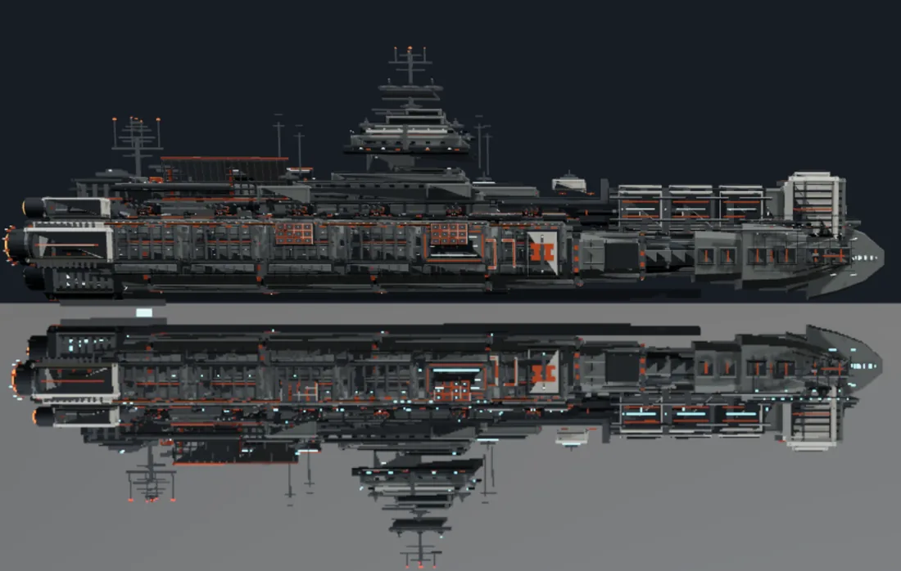
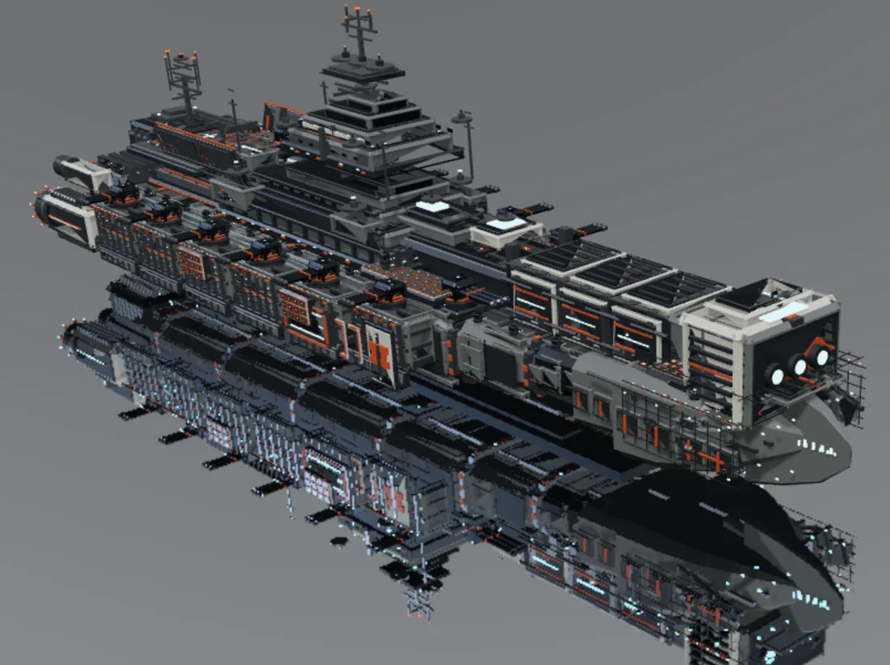
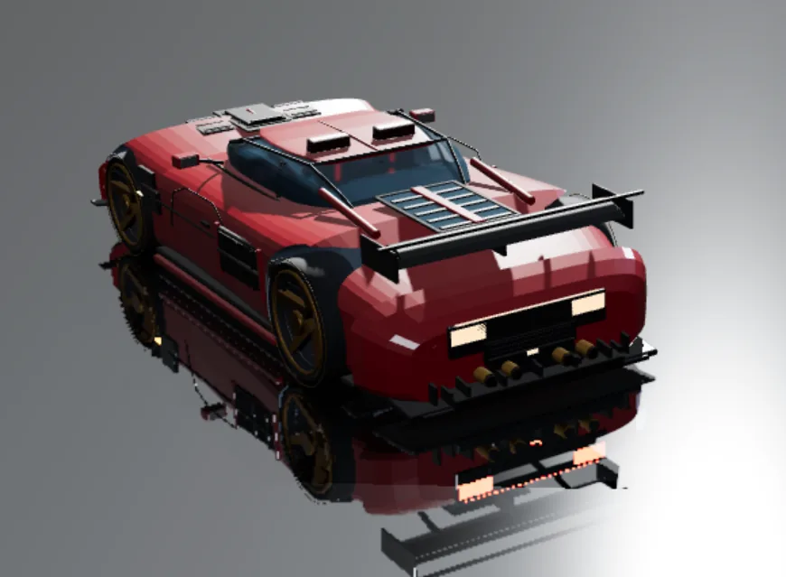

# dsh-modeler

[中文](README.md) | **English**

**A built-in 3D modeling studio for DeepSeek Harness, built on Three.js.**

`dsh-modeler` turns a DSH chat session into a persistent, versioned 3D modeling workspace. Agents create and edit geometry, prepare PBR materials, observe the result through real Three.js renders, and deliver the exact version — without leaving the harness.

> Current version **`1.0.0-alpha-1`**. Usable and tested, but alpha releases may still adjust tool contracts.

## Showcase

<table>
<tr>
<td width="33%"></td>
<td width="33%"></td>
<td width="33%"></td>
</tr>
<tr>
<td align="center">Capital ship · side / top</td>
<td align="center">Capital ship · isometric</td>
<td align="center">Hypercar · studio mirror</td>
</tr>
</table>

> Generated with **DeepSeek-V4.1-Flash-Max + PTC tool calls** from a few-dozen-word wish prompt, **one conversation round**, no manual retouching. These are observation captures, not marketing renders.

## Why it exists

Most "AI + 3D" setups stop at generating a mesh file. `dsh-modeler` gives the agent a full loop:

- **Persistent, editable assets** — every part has a stable semantic ID, a source declaration, ordered features and a version history. Edits are local, replayable and guarded by `assetId` + `contentHash`.
- **Three.js at the core** — the viewport, snapshots, material previews and exports share one evaluation kernel and one renderer path. What you see in a capture is the scene the viewport draws.
- **Materials that survive** — uniform PBR and spatial `.mat` / `.finish` / material-library authoring share automatic display preparation (UVs, bakes, textures). No separate bake step for normal viewing.
- **Observation with intent** — captures declare a purpose: `shape` → outline, `topology` → surface wireframe, `appearance` → material. The renderer never silently substitutes a material image for an undeclared question.
- **Versioned delivery** — export a ticket-bound package with manifest, digest and source identity.

## Features

| Area | What you get |
|---|---|
| Geometry | API3 sources (`box`, `cylinder`, `sphere`, `torus`, `mesh`, `loft`, `extrude`, `curve`, `surface`, `sweep`), ordered features (bevel, inset, boolean, subdivision, mirror, array…), local edits, named selections |
| Assembly | modules, interfaces, relations, contact intent vs measured contact, assembly checks |
| Materials | recipes (paint, metals, rubber, glass, carbon…), spatial signals, detail tiles, material library, automatic display preparation |
| Observation | real Three.js PNG captures, `shape`/`topology`/`appearance` purposes, transient studio lighting, mirror floor, semantic outline, surface wireframe, channel diagnostics |
| Delivery | versioned package with manifest, digest and consumer import contract |
| Legacy | the old `modeler_script` DSL remains supported for existing assets |

## Requirements

- **DeepSeek Harness (DSH)** with the plugin manager available (`plugin_manager` tool).
- **Node.js 20+** — only if you build from source; the released package already contains built client bundles.
- **Optional: Blender** — required only for native API3 geometry jobs and material baking. Display, observation, legacy script assets and delivery work without it.

## Install (for humans and AI agents)

### From a GitHub release (recommended)

1. Open **Releases** and download `dsh-modeler-1.0.0-alpha-1.zip`.
2. Extract it to a stable absolute path, for example:
   - Windows: `C:\Users\<you>\dsh-modeler`
   - macOS/Linux: `~/dsh-modeler`
   The extracted folder must contain `package.json` and `index.js` at its root.
3. If an older copy is installed, remove it first:

   ```json
   {"action":"remove_bundle","target":"@local/dsh-modeler"}
   ```

4. Install the extracted folder by **absolute path**:

   ```json
   {"action":"install_bundle","target":"C:\\Users\\<you>\\dsh-modeler"}
   ```

5. Confirm the result contains `"application": "applied"`.
6. **Refresh the DSH page** so the browser loads the new client bundle.

### From source

```bash
git clone https://github.com/WestFox-AwA/dsh-modeler.git
cd dsh-modeler
npm install
node build.mjs
```

Then install the repository folder with `install_bundle` exactly as in step 4, and refresh the page.

### Verify the install

```json
{"action":"status"}
```

`clientBuildId` must match the build recorded in `client-build.json`, and `bound` may be `false` until you open or create an asset. Then:

```json
{"action":"guide","args":{"id":"main"}}
```

A guide payload confirms the plugin is live.

### Updating

Remove the old bundle, install the new extracted folder, refresh the page. Assets live outside the plugin (`~/.dsh/modeler-resources`) and are not touched by reinstalling.

## Quick start for agents

```text
modeler_workbench {action:"guide", args:{id:"main"}}      # mental model + directory
modeler_workbench {action:"guide", args:{id:"construct"}} # API3 geometry
modeler_geometry  {op:"program", code:"..."}              # create parts
modeler_capture   {purpose:"shape", isolate:"panel"}      # outline snapshot
modeler_capture   {purpose:"appearance"}                  # PBR snapshot
```

Capture purposes:

| `purpose` | Rendered as | Use for |
|---|---|---|
| `shape` | outline | silhouettes, part boundaries, seams |
| `topology` | surface wireframe | triangles, edge flow, mesh structure |
| `appearance` | normal PBR | materials, glass, lighting |

An explicit `displayMode` always overrides the purpose. A public capture with none of `purpose`, `displayMode` or a diagnostic `mode` is rejected **before** any asset read or render, with `capture_purpose_required`.

## Repository layout

```text
index.js              Host plugin: tools, routes, resource wiring
src/                  Browser sources: workbench, renderer, observation, floor, materials
client.js             Built browser bundle (loaded by DSH)
capture.js            Built capture renderer bundle
lib/                  Kernel, workspace, materials, evidence, guides, operations
runtime/              Optional Blender-backed native geometry/material worker
docs/                 Agent guides and contracts (start at docs/AGENT-GUIDE.md)
tests/                Self-contained regression suites
build.mjs             Bundles src/ into client.js and capture.js
```

## Data and privacy

- Assets are stored under `~/.dsh/modeler-resources` on your machine. This repository contains **no user assets, session logs or private evidence**.
- Captures are written to `~/.dsh/modeler-evidence` and are bound to an exact `contentHash`.
- The plugin does not upload your models anywhere.

## Versioning and license

`1.0.0-alpha-1` is the first public alpha. Tool contracts are documented through `modeler_workbench {action:"help"}` and the guides; alpha releases may still adjust behavior. Pin a release if you need stability.

[MIT](LICENSE) © WestFox-AwA

## Contributing

Issues and pull requests are welcome. Please keep the evidence boundaries intact: geometry measurements, rendered images and author declarations are different kinds of proof, and a passing test is not an aesthetic approval.
