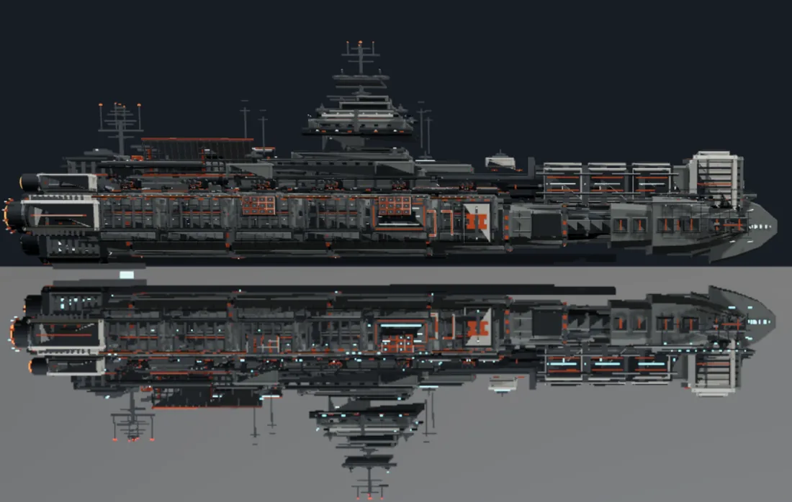
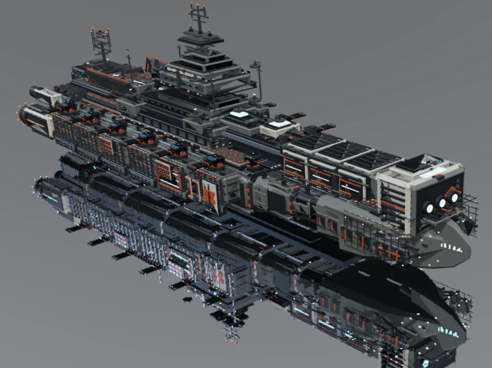
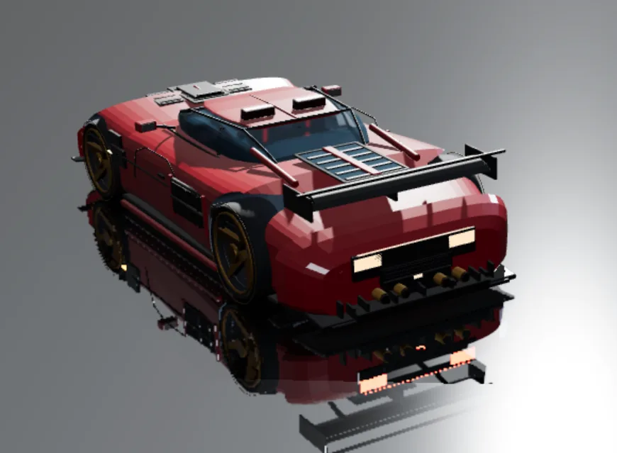

# dsh-modeler

**中文** | [English](docs/README.en.md)

**DeepSeek Harness 的内置 3D 建模工作室，以 Three.js 为核心。**

`dsh-modeler` 把一个 DSH 对话会话变成持久、可版本化的 3D 建模工作区：代理可以创建与编辑几何、准备 PBR 材质、用真实 Three.js 渲染观察结果，并交付确切版本——全程不离开 Harness。

> 当前版本 **`1.0.0-alpha-2`**。功能可用且经过测试，但 alpha 阶段仍可能调整工具契约。

## 效果展示

<table>
<tr>
<td width="33%"></td>
<td width="33%"></td>
<td width="33%"></td>
</tr>
<tr>
<td align="center">主力舰 · 侧视 / 俯视</td>
<td align="center">主力舰 · 斜视</td>
<td align="center">超跑 · 工作室镜面</td>
</tr>
</table>

> 生成条件：**DeepSeek-V4.1-Flash-Max + PTC 工具调用**，仅凭几十字的许愿提示词**一轮对话生成**，未手工修模。图为主力舰与超跑的观察截图，不是宣传渲染。

## 它解决什么

多数“AI + 3D”停在导出一个网格文件。`dsh-modeler` 给代理一个完整闭环：

- **持久、可编辑的资产**：每个部件有稳定语义 ID、源声明、有序特征和版本历史；编辑是局部的、可回放的，并由 `assetId` + `contentHash` 守卫。
- **Three.js 为核心**：视口、快照、材质预览和导出共用同一求值内核与同一条渲染路径。截图里看到的就是视口绘制的场景。
- **材质能留下来**：均匀 PBR 与空间 `.mat` / `.finish` / 材质库共用自动显示准备（UV、烘焙、贴图），日常观察不需要额外 bake。
- **带意图的观察**：截图先声明用途——`shape` → 描边、`topology` → 表面线框、`appearance` → 材质。渲染器不会在未声明问题时静默用材质图代替。
- **版本化交付**：导出带清单、摘要和源身份的交付包，供下游校验。

## 功能

| 领域 | 内容 |
|---|---|
| 几何 | API3 源（`box`、`cylinder`、`sphere`、`torus`、`mesh`、`loft`、`extrude`、`curve`、`surface`、`sweep`），有序特征（倒角、内插、布尔、细分、镜像、阵列…），局部编辑，命名选区 |
| 装配 | 模块、接口、关系、接触意图与实测接触、装配检查 |
| 材质 | 工艺配方（喷漆、金属、橡胶、玻璃、碳纤维…）、空间信号、细节平铺、材质库、自动显示准备 |
| 观察 | 真实 Three.js PNG 截图、`shape`/`topology`/`appearance` 用途、瞬态工作室灯光、镜面地板、语义描边、表面线框、通道诊断 |
| 交付 | 带清单、摘要和消费者导入契约的版本化交付包 |
| 兼容 | 旧 `modeler_script` DSL 继续支持既有资产 |

## 环境要求

- **DeepSeek Harness（DSH）**，并可用 `plugin_manager` 工具。
- **Node.js 20+**：仅在从源码构建时需要；发布包已包含构建好的客户端。
- **可选 Blender**：仅原生 API3 几何作业和材质烘焙需要。显示、观察、旧脚本资产和交付不需要。

## 安装（人和 AI 都能照做）

### 从 GitHub Release 安装（推荐）

1. 打开 **Releases**，下载 `dsh-modeler-1.0.0-alpha-2.zip`。
2. 解压到一个固定的绝对路径，例如：
   - Windows：`C:\Users\<你>\dsh-modeler`
   - macOS/Linux：`~/dsh-modeler`
   解压后的目录根部必须直接包含 `package.json` 和 `index.js`。
3. 如已安装旧版，先移除：

   ```json
   {"action":"remove_bundle","target":"@local/dsh-modeler"}
   ```

4. 用**绝对路径**安装解压目录：

   ```json
   {"action":"install_bundle","target":"C:\\Users\\<你>\\dsh-modeler"}
   ```

5. 确认返回包含 `"application": "applied"`。
6. **刷新 DSH 页面**，让浏览器加载新的客户端包。

### 从源码安装

```bash
git clone https://github.com/WestFox-AwA/dsh-modeler.git
cd dsh-modeler
npm install
node scripts/build.mjs
```

然后按第 4 步用 `install_bundle` 安装仓库目录，并刷新页面。

### 验证安装

```json
{"action":"status"}
```

`clientBuildId` 应与 `client-build.json` 一致；`bound` 在打开或新建资产前可以是 `false`。再执行：

```json
{"action":"guide","args":{"id":"main"}}
```

能返回指南内容即表示插件已生效。

### 更新

移除旧 bundle → 安装新目录 → 刷新页面。资产存放在插件之外（`~/.dsh/modeler-resources`），重装不会影响它们。

## 代理快速开始

```text
modeler_workbench {action:"guide", args:{id:"main"}}      # 心智模型与目录
modeler_workbench {action:"guide", args:{id:"construct"}} # API3 几何
modeler_geometry  {op:"program", code:"..."}              # 创建部件
modeler_capture   {purpose:"shape", isolate:"panel"}      # 描边截图
modeler_capture   {purpose:"appearance"}                  # 材质截图
```

截图用途：

| `purpose` | 实际渲染 | 用于 |
|---|---|---|
| `shape` | 描边 | 轮廓、部件边界、接缝 |
| `topology` | 表面线框 | 三角面、布线、网格结构 |
| `appearance` | 标准 PBR | 材质、玻璃、灯光 |

显式 `displayMode` 永远优先于用途。公共截图若 `purpose`、`displayMode` 和诊断 `mode` 都没给，会在**读取资产和启动渲染之前**以 `capture_purpose_required` 拒绝。

## 仓库结构

```text
index.js              Host 插件入口：工具、路由、资源接线
src/                  源码：client.*（浏览器）、host/（Host 逻辑）、runtime/（Blender worker）
dist/                 构建产物：client.js（DSH 加载）、capture.js、client-build.json
assets/               图标、locale、Cordis 补丁
docs/                 代理指南与契约（从 docs/AGENT-GUIDE.md 开始）
tests/                自包含回归套件
scripts/build.mjs     打包 src/ → client.js 与 capture.js
```

## 数据与隐私

- 资产存放在本机 `~/.dsh/modeler-resources`。本仓库**不包含任何用户资产、会话日志或私有证据**。
- 截图写入 `~/.dsh/modeler-evidence`，并绑定确切的 `contentHash`。
- 插件不会把你的模型上传到任何地方。

## 版本与许可

`1.0.0-alpha-2` 是第二个公开 alpha。工具契约通过 `modeler_workbench {action:"help"}` 与指南给出；alpha 期间行为仍可能调整，需要稳定请固定版本。

[MIT](LICENSE) © WestFox-AwA

## 参与

欢迎 issue 与 PR。请保留证据边界：几何测量、渲染图像和作者声明是不同种类的证明，测试通过不等于外观验收。
